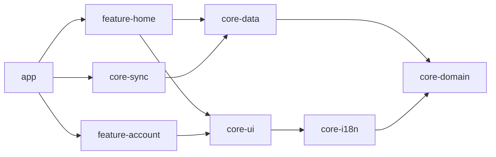

<div align="center">

# AgroShift

**A field-first Android companion for Pakistani farmers, built with Java, NASA Earth data and local languages.**


### [Download the Android APK (0.6.1 preview, 7.4 MB)](https://github.com/abdulrehman688/agroshift_ai/raw/main/releases/AgroShift-0.6.1-preview.apk)

</div>

> **Preview build:** it passes the build, lint and 78 automated tests, but has not yet been confirmed on a physical phone. It uses a development signature, so Android may ask you to allow installation from this source.

## Overview

AgroShift helps farmers decide what to do on their own land, keep farm records, and get help in their language. The app is designed for weak connectivity, low-cost phones and outdoor use.

It combines each farmer's field with NASA climate data. When evidence is missing, the app is designed to say so instead of guessing.

## What is in the app

- Bilingual Urdu and English onboarding with real Pakistani farm photography
- Modern Home with a live weather sky, all-farms switcher, 7-day forecast, draggable Rabi and Kharif crop timeline, field map and quick actions
- Live canal turn scene with countdown and soil water meter
- Interactive Farm, field records and Market pages with progress, filters and sales charts
- Full-screen map field setup with a draggable form, GPS, place search and satellite view
- Daily irrigation estimate from forecast rain, evapotranspiration, soil and your last watering date
- Weekly canal turn (warabandi) alarm that survives phone restarts
- Frost, heat, heavy rain and strong wind alerts for the next three days
- Crop rotation analysis from 20 years of NASA POWER data, with scores, risks, reasons and actions
- What-If scenarios for heat and lower rainfall
- Farm tasks, costs, sales, notes and profit, saved offline with Room
- Field-aware assistant with voice input, read aloud and copy on every answer
- Chat in English, Urdu, Punjabi and Sindhi, with Saraiki in beta
- Market and Help sections, with official AMIS price access
- Zameen design system with safe areas, large touch targets and right-to-left layout

Urdu is a machine draft awaiting native review. Punjabi, Sindhi, Pashto, Saraiki and Balochi can be selected for the app, and their screens show English until translated.

## Sprint plan

| Sprint | Focus | Status |
|---|---|---|
| **1. Useful every day** | Map room, modern Home, irrigation answer, canal turn alarm, danger alerts | Built, awaiting phone test |
| **2. Course requirements** | Proposal gaps, tests, topic-to-code report, proposal wording | Planned |
| **3. Polish and performance** | Remaining UX patterns, final fonts, sunlight theme, low-end performance | Planned |
| **4. Big features** | Spring Boot backend, daily data pipeline, Field Lens, more languages | Planned |
| **Later** | Listings, machinery rental, community | If time allows |

See the full [roadmap](docs/Roadmap.md).

## Architecture



| Module | Responsibility |
|---|---|
| `app` | Activity, navigation, command menu and dependency wiring |
| `feature-home` | Home screen |
| `feature-farm` | Field setup, field details and farm records |
| `feature-advisor` | Crop rotation analysis and What-If |
| `feature-market` | Market section |
| `feature-help` | Help, crop guide and assistant |
| `feature-account` | Language selection and onboarding |
| `core-ui` | Zameen theme and reusable components |
| `core-i18n` | Language selection and translated strings |
| `core-data` | Room database and repositories |
| `core-sync` | WorkManager outbox synchronization |
| `core-domain` | Pure Java models, validation, season logic and concurrency |

## Tech stack

| Layer | Technology |
|---|---|
| Language | Java 17 |
| UI | Android Views, Material Components, AndroidX Navigation |
| Local data | Room |
| Background work | WorkManager |
| Testing | JUnit 4 |
| Planned backend | Spring Boot, PostgreSQL |
| Maps | osmdroid |
| Networking | Retrofit, Gson, OkHttp |

## Getting started

### Requirements

- JDK 21 to run Gradle
- Android SDK 34
- Android 7.0 or later device or emulator

### Build and test

```bash
git clone https://github.com/abdulrehman688/agroshift_ai.git
cd agroshift_ai
./gradlew :core-domain:test :app:assembleDebug
```

The debug APK is created at `app/build/outputs/apk/debug/app-debug.apk`.

## Data and safety principles

- Every data value must keep its source and date.
- Phones receive processed field results and never download raw satellite files.
- NASA data describes field conditions. It does not identify a crop disease from a photo.
- Fertilizer and pesticide amounts may only be shown from human-reviewed official sources.
- AI must never create, estimate or calculate a dose.
- Credentials stay on the backend and are never committed or shipped in the app.

Planned data sources are listed in [Data Sources](docs/Data%20Sources.md).

## Documentation

The [`docs`](docs/Home.md) folder is an [Obsidian](https://obsidian.md) vault and also reads normally on GitHub.

- [Project home](docs/Home.md)
- [Roadmap](docs/Roadmap.md)
- [Architecture](docs/Architecture.md)
- [Design system](docs/Zameen%20Design%20System.md)
- [UX patterns](docs/UX%20Patterns.md)
- [Course mapping](docs/Course%20Mapping.md)
- [Image credits](docs/Image%20Credits.md)
- [Changelog](CHANGELOG.md)

## Acknowledgments

- Project concept builds on the earlier [NASA AgroShift AI](https://github.com/asifnawaz23/nasa_agroshift_AI) work.
- Interface principles adapted from [unslop](https://github.com/heydamir/unslop) by Damir Sokolovsky, licensed CC BY 4.0.
- App photographs come from Wikimedia Commons contributors under CC BY and CC BY-SA licenses. See [Image Credits](docs/Image%20Credits.md).
- Climate and Earth observation data comes from NASA programs. AgroShift is not affiliated with or endorsed by NASA.

## Academic context

AgroShift is developed for the Software Construction and Development course at Sir Syed University of Engineering and Technology.
