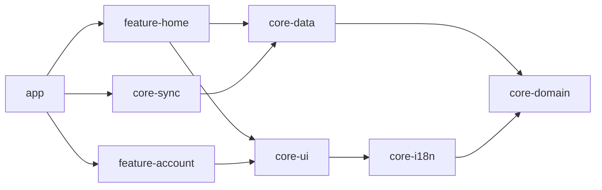

# Architecture

Back to [[Home]]

| Module | Responsibility |
|---|---|
| `app` | Activity, navigation, command menu and app wiring |
| `feature-home` | Home and add-field flow |
| `feature-account` | Language onboarding |
| `core-ui` | Zameen theme and components |
| `core-i18n` | Language selection and strings |
| `core-data` | Room database and repositories |
| `core-sync` | WorkManager outbox sync |
| `core-domain` | Pure Java models, rules and concurrency |

## Data flow

The UI reads from Room. A change writes the data and its outbox entry in one transaction. WorkManager sends queued entries once a backend gateway exists.

## Planned backend

Spring Boot, PostgreSQL and scheduled collectors. See [[Data Sources]].

## Performance rules

- Phones never download raw NASA files.
- Screens render local data first.
- The server prepares small per-field evidence packs.
- Long work stays off the main thread.
