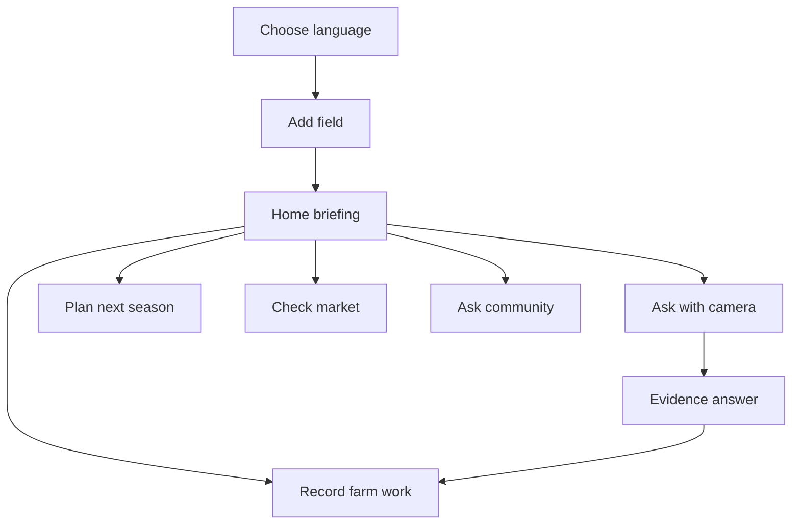

# User Flows

Back to [[Home]]

## Main journey

## Principles

- Value appears before account creation.
- Each screen has one main message and one main action.
- Important actions work by voice, icon and text.
- Changes save immediately and can be undone.
- Every fact shows its source and date.

## Built today

1. Choose a language.
2. Add a field.
3. Swipe to remove it, then undo.
4. Reopen the app with data intact.
5. Use search to move between sections.
